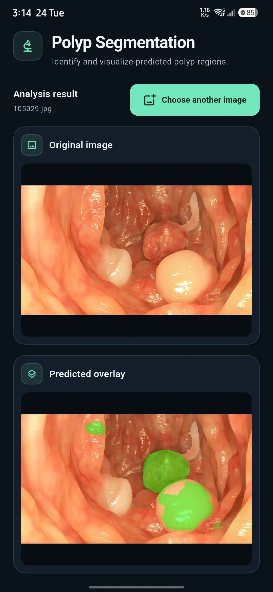
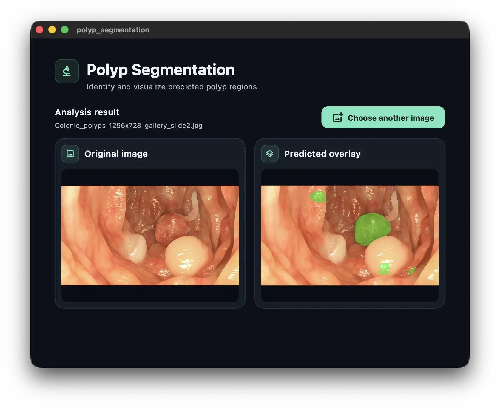

# Polyp Segmentation

A Flutter research prototype for visualizing predicted polyp regions in colonoscopy images. Choose a JPEG or PNG image and the app runs a bundled TensorFlow Lite segmentation model locally, then displays the original image beside (or above) its green prediction overlay.

> **Research prototype:** This app is for software and model evaluation. Its predictions have not been validated for clinical use and must not be used to diagnose or guide treatment.

## Screenshots

### Android

The image panels are stacked vertically on a narrow screen.

<p align="center">
  
</p>

### macOS

On a wide screen, the original image and predicted overlay are shown side by side.

<p align="center">
  
</p>

## Features

- Select JPEG or PNG images from the device gallery or file picker.
- Run local inference using the bundled `assets/lightweight_unet.tflite` model; image data is not sent to a server by this app.
- Compare the source image with a green overlay of pixels predicted as polyp regions.
- Show image-processing progress and readable errors for unsupported or unreadable images.
- Adapt the comparison layout to screen width: stacked on phones and side by side on wider screens.
- Recover an image selection if Android recreates the activity while the system picker is open.

## How segmentation works

1. The selected image is decoded, its orientation is corrected, and it is converted to RGB.
2. The image is resized to **256 × 256** and each RGB channel is scaled to the **0–1** range.
3. The bundled model predicts a probability for each pixel. A threshold of **0.5** marks pixels for the overlay.
4. Marked pixels are blended with green at **45% opacity**. The resulting overlay is resized to preserve the source aspect ratio, with its longest side capped at **640 pixels**.

Inference runs in a Dart worker isolate using LiteRT, keeping model processing off the Flutter UI thread. The model's output is a visualization only; the app does not calculate clinical measurements or diagnostic metrics.

## Run the app

### Requirements

- Flutter SDK compatible with the Dart constraint in `pubspec.yaml` (`^3.10.0`).
- For Android: Android Studio/Android SDK and a device or emulator running **Android API 24 or later**.
- For macOS: macOS with Xcode and the macOS desktop build tools installed.

Fetch the Flutter packages:

```sh
flutter pub get
```

### macOS

```sh
flutter run -d macos
```

### Android

Connect an Android device with USB debugging enabled, or start an emulator. Find its device ID and run the app:

```sh
flutter devices
flutter run -d <android-device-id>
```

Build a debug APK:

```sh
flutter build apk
```

The first build may need internet access to download Flutter packages and native dependencies.

## Project structure

| Path | Purpose |
| --- | --- |
| `lib/main.dart` | App entry point and root `MaterialApp`. |
| `lib/ui/app_theme.dart` | Dark theme, typography, and shared colors. |
| `lib/ui/image_screen.dart` | Image selection, inference state, errors, and responsive screen layout. |
| `lib/ui/empty_panel.dart` | Initial panel shown before an image is selected. |
| `lib/ui/image_comparison.dart` | Original and overlay image panels. |
| `lib/ui/icon_tile.dart` | Reusable icon tile used by the screen and panels. |
| `lib/segmentation.dart` | Image preprocessing, LiteRT inference, and overlay generation. |
| `assets/lightweight_unet.tflite` | Exported segmentation model bundled with the app. |
| `assets/screenshot/` | Android and macOS screenshots included above. |

## Current limitations

- Input images are stretched to a square for model inference. The displayed overlay is resized back to the source aspect ratio, but the prediction can still be affected by that square input resize.
- The output is thresholded at 0.5 and shown as a qualitative green overlay. No confidence report, uncertainty estimate, or clinical metric is produced.
- Performance and prediction quality depend on the bundled model and the input image. The app is a research prototype, not a medical device.
- Compare predictions against the project's reference implementation and labeled test data before making claims about accuracy or numerical parity.
